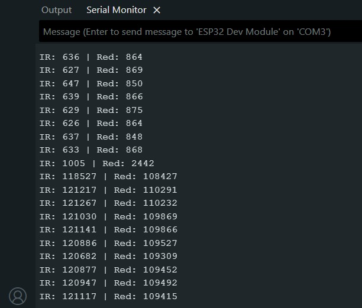
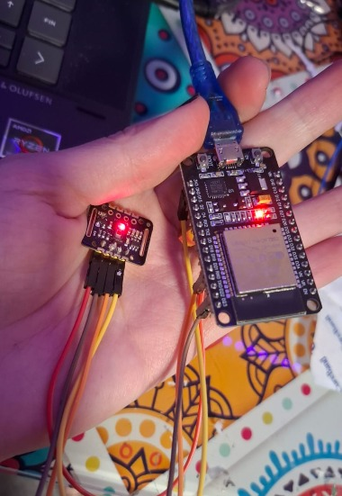
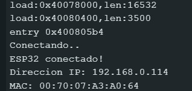

# SANITAS — Sistema de Monitoreo Biomédico IoT

## Descripción del proyecto

SANITAS es un prototipo de dispositivo wearable basado en ESP32, diseñado para monitorear variables biomédicas como frecuencia cardiaca, saturación de oxígeno (SpO₂), temperatura y movimiento.

El objetivo es desarrollar un sistema que permita visualizar estas mediciones de manera remota y generar alertas ante posibles situaciones de riesgo.

## Sensores utilizados

| Sensor | Función | Estado |
|---|---|---|
| MAX30102 | Frecuencia cardiaca y estimación de SpO₂ | Lecturas obtenidas con ESP32 |
| MPU6050 | Acelerómetro y giroscopio | Lecturas obtenidas con ESP32 |
| MLX90614 | Temperatura infrarroja | Pendiente de resolver |
| LM35 | Alternativa para temperatura | Pendiente de prueba |

## Arquitectura propuesta

El sistema contempla los siguientes componentes:

- **ESP32:** adquisición y procesamiento de datos.
- **Wi-Fi 802.11 b/g/n:** conexión inalámbrica.
- **MQTT:** protocolo para transmitir mediciones.
- **Eclipse Mosquitto:** broker MQTT.
- **InfluxDB 2.0:** almacenamiento de datos.
- **Grafana:** visualización mediante un dashboard.

Hasta el momento se ha comprobado la adquisición de datos mediante ESP32 y su conexión Wi-Fi. La integración con MQTT, la base de datos y el dashboard corresponde a etapas posteriores.

## Avances de la Etapa 2

### 1. Lectura del sensor MAX30102

Se logró establecer comunicación I²C entre el sensor MAX30102 y el ESP32 mediante los pines D21 (SDA) y D22 (SCL).

Durante las pruebas se obtuvieron lecturas de las señales infrarroja (IR) y roja (Red).

**Resultados observados:**

| Condición | IR | Red |
|---|---:|---:|
| Sin dedo | 548–674 | 749–776 |
| Con dedo | 115590–123163 | 108702–112645 |

### Evidencia de lectura MAX30102

Estos resultados muestran una respuesta significativa de ambas señales al colocar el dedo sobre el sensor.

También se realizaron pruebas experimentales de estimación de frecuencia cardiaca y SpO₂. Sin embargo, estas mediciones todavía requieren ajustes y validación.

### Montaje físico del sensor MAX30102

Fotografía del sensor MAX30102 conectado al ESP32 mediante comunicación I2C.

### 2. Lectura del MPU6050

Se logró obtener información de aceleración en los ejes X, Y y Z mediante comunicación I²C con el ESP32.

Estas mediciones servirán como base para desarrollar un algoritmo de detección de posibles caídas.

**Evidencia:** agregar captura de las aceleraciones en el Monitor Serie.

### 3. Sensor de temperatura

Se realizaron pruebas iniciales con el MLX90614, pero no fue posible establecer comunicación con el sensor.

Se contempla evaluar el LM35 como alternativa para la adquisición inicial de temperatura.

**Estado:** pendiente de integración y validación.

### 4. Pruebas de conectividad Wi-Fi

Se consiguió conectar el ESP32 a una red Wi-Fi y obtener una dirección IP local.

### Conexión Wi-Fi del ESP32

Se realizó una prueba de conexión inalámbrica del ESP32 a una red Wi-Fi, obteniendo una dirección IP local que permitió comprobar su incorporación a la red.

También se realizó una prueba de conectividad mediante el comando ping.

**Resultado registrado:**

- Dirección IP: 192.168.0.114
- Respuesta del ping: 32 bytes
- Tiempo de respuesta: 132 ms
- TTL: 64

Estas pruebas permitieron comprobar la comunicación del ESP32 dentro de la red local.

**Evidencias:**
- Captura del Monitor Serie mostrando la conexión y la IP.
- Captura del ping exitoso.

### 5. Observaciones del MAX30102

Durante las pruebas se observaron pequeñas fluctuaciones en las señales IR y Red, así como variaciones importantes en las primeras estimaciones de frecuencia cardiaca.

Estas variaciones pueden estar relacionadas con el movimiento del dedo, la presión aplicada sobre el sensor y las condiciones de iluminación.

Se realizaron pruebas con promedios para reducir las fluctuaciones, aunque todavía es necesario mejorar la estabilidad y validar las mediciones.

## Diagrama de conexiones

Agregar aquí el diagrama general que muestra cómo se conectan los sensores MAX30102, MPU6050 y temperatura al ESP32.

## Próximos pasos

- Completar la prueba del sensor de temperatura.
- Integrar los sensores en un mismo programa.
- Mejorar la estabilidad de las estimaciones de frecuencia cardiaca y SpO₂.
- Implementar comunicación mediante MQTT.
- Configurar el almacenamiento de datos.
- Desarrollar el dashboard de monitoreo.
- Implementar alertas automáticas.

## Estado actual

El proyecto se encuentra en su segunda etapa de desarrollo. Se han realizado pruebas de adquisición de datos con sensores y se ha verificado la conectividad Wi-Fi del ESP32.

Las siguientes etapas estarán enfocadas en la integración del hardware, la transmisión de información y la visualización remota de las mediciones.
